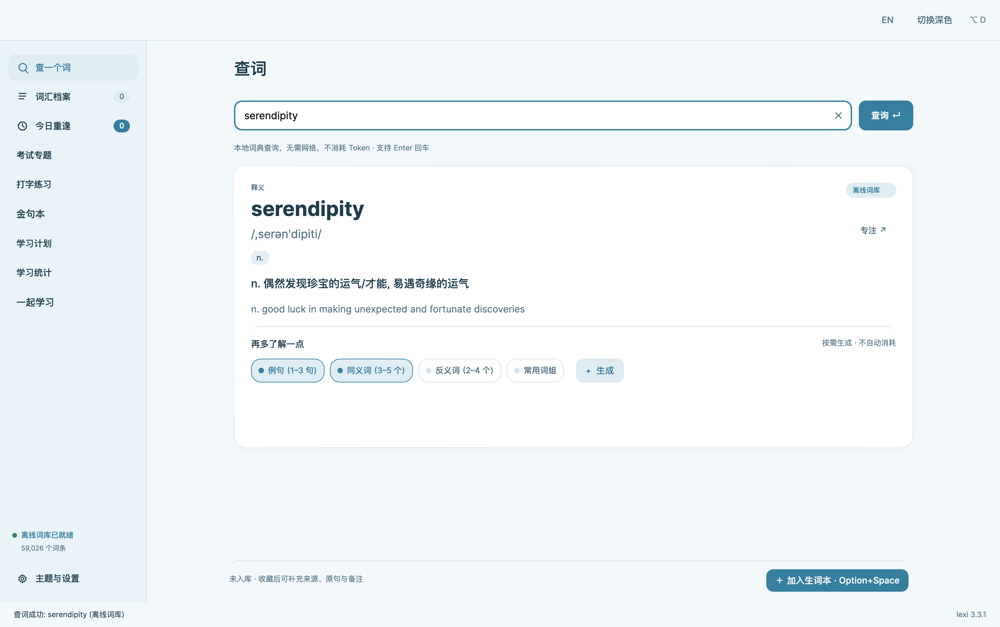
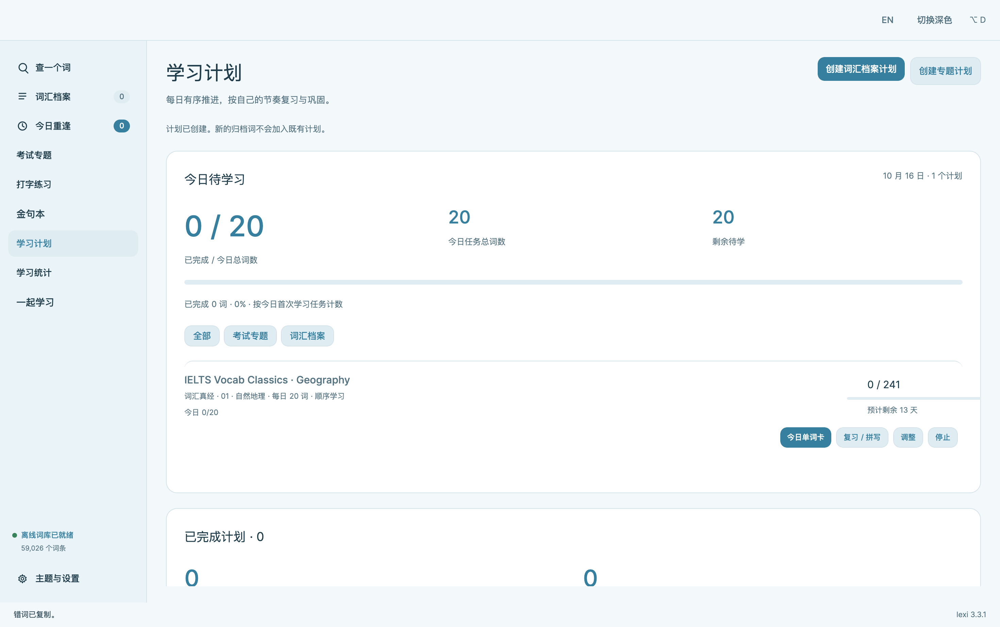
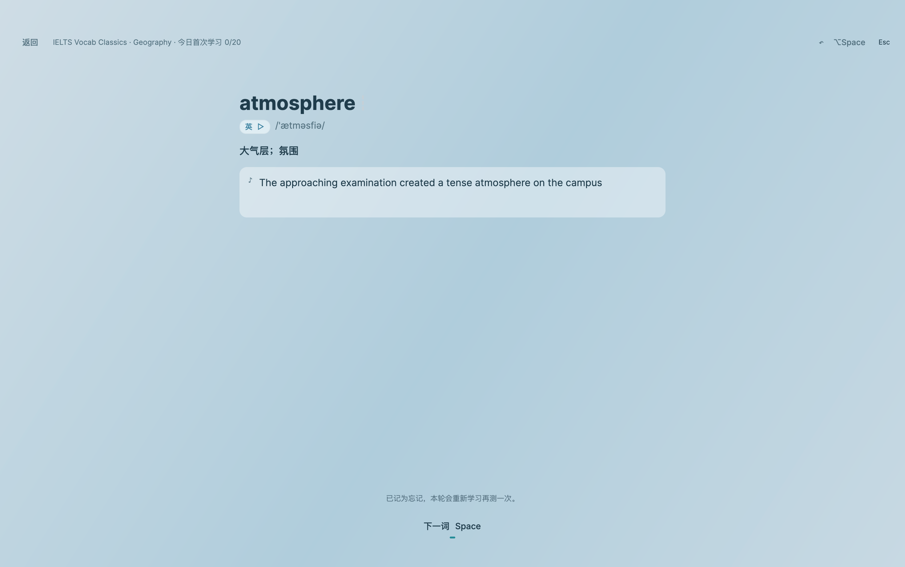
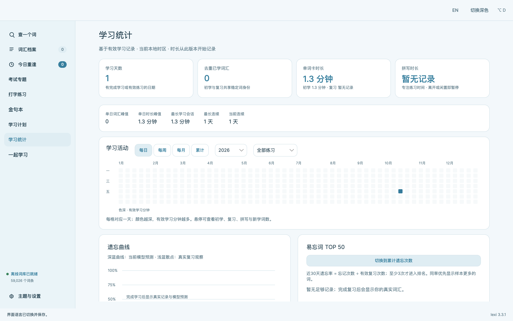

<div align="center">

# Lexi · 把阅读中的生词，变成自己的长期记忆

**macOS 英语学习应用 · 流畅的小卡片交互 · 冰川蓝界面 · 本机个性化记忆系统 · 七大考试专题 · 一起学习**

[下载与版本记录](https://github.com/DespairJasper/lexi-macos/releases) · [使用与安装](#安装与开始使用) · [考试与词书](#考试专题与完整词书目录) · [一起学习](#一起学习--续命局) · [记忆系统](#复习逐渐适应你的记忆) · [源码构建](#从源码构建)

Apple Silicon · macOS 12+ · 中英文界面 · 离线词典

</div>

---

Lexi 把查词、阅读摘录、词汇整理和日常学习放在同一个应用里。阅读时用快捷小卡片查词或翻译，想记住的词收入档案，再按自己的计划学习。复习由记忆模型安排，无需手动计算间隔。

当前源码版本为 **3.3.1**，安装包为 `Lexi-3.3.1-macOS-arm64.dmg`。前往 [3.3.1 发布页](https://github.com/DespairJasper/lexi-macos/releases/tag/v3.3.1) 下载。更新沿用原数据目录与数据库身份；时长记录独立保存于 `study-activity.json`，旧版未记录的时长显示“暂无记录”。

## 从阅读到学习，操作自然衔接

| 场景 | Lexi 的交互 |
| --- | --- |
| 阅读遇到生词 | 选中文字，按 `⌥D` 呼出查词卡片，查看释义、音标和发音，收藏到词汇档案 |
| 想读懂一句话 | `⌥A` 打开翻译卡片；配置 AI 服务后，译文以流式方式逐步出现 |
| 遇到值得留住的表达 | `⌥S` 收藏金句，保存原文、译文、来源与备注，之后可搜索、编辑与导出 |
| 开始当天学习 | 在档案或七大考试专题中选词、建计划，设置每日数量与顺序，查看预计完成天数 |
| 检验自己是否记住 | 先学后测，用“认识 / 模糊 / 忘记”作答；三格进度反馈当前轮次，支持改判与撤销 |
| 巩固拼写 | 淡写、默写与自动发音配合练习；逐字反馈、正确与错误音效、错误抖动帮助定位问题 |

跨应用快捷键可在设置中修改；小卡片也支持手动输入。多个每日计划可同时进行，词汇档案与考试词书分别记录进度；计划可调整、停止、恢复，停止后可删除。

## 考试专题与完整词书目录

主导航的「考试专题」包含 **IELTS、四级、六级、考研、GMAT、TOEFL、GRE**。先选考试，再选具体词书与单元；可按整本、单元或选中词条建立每日计划。专题学习支持单词卡认词、淡写和默写，配合发音、错词筛选与长期复习。切换中文 / English 时，考试、书名和单元标签同步切换，并保留当前选择。

### IELTS：词书与配套资料

IELTS 保留以下六类资料。词汇资料可进入认词、淡写与默写；写作、语法和听力资料按各自页面提供练习或资料入口。

| 词书 / 资料 | 实际收录与用法 |
| --- | --- |
| **雅思词汇真经**（页面名「词汇真经」） | 22 个主题章节、3,674 条词条，按逻辑词群组织，含章节音频与词汇练习 |
| **听力 179 考点词**（页面名「听力 179」） | 179 条听力考点词及同义替换，配套音频，可做听写与同义替换练习 |
| **阅读同义替换** | 376 条阅读考点词，分第 1 类、第 2 类、第 3 类三个单元，支持查看和练习同义表达 |
| **英美拼写规范** | 72 条拼写规范条目，对照美式、英式及通用拼写 |
| **写作 100 句** | 100 句写作练习，提供中文题目、参考表达、替代表达及已有备注 |
| **语法与听力资料** | 配套语法讲解与听力资料入口；这是资料分类，不另外计为一本词汇书 |

词汇真经的 22 章为：自然地理、植物研究、动物保护、太空探索、学校教育、科技发明、文化历史、语言演化、娱乐运动、物品材料、时尚潮流、饮食健康、建筑场所、交通旅行、国家政府、社会经济、法律法规、沙场争锋、社会角色、行为动作、身心健康、时间日期。

### 四级、六级、考研、GMAT、TOEFL、GRE：20 本词书

下面使用应用内实际书名列出全部词书；括号内为该书收录条目数。

| 考试专题 | 词书数量 | 完整书目 |
| --- | --- | --- |
| 大学英语四级 CET-4 | 5 本 | **四级英语词汇（正序版）**（3,739 条）；**四级真题核心词（图片记忆）**（1,162 条）；**四级英语词汇**（3,739 条）；**新东方四级词汇**（2,607 条）；**四级真题核心词（正序版）**（1,162 条） |
| 大学英语六级 CET-6 | 4 本 | **六级英语词汇**（2,078 条）；**六级真题核心词（图片记忆）**（1,228 条）；**新东方六级词汇**（2,345 条）；**六级真题核心词（正序版）**（1,228 条） |
| 考研英语 | 4 本 | **考研英语词汇**（4,533 条）；**考研必考词汇**（1,340 条）；**新东方考研词汇**（3,728 条）；**考研必考词汇（正序版）**（1,340 条） |
| GMAT | 3 本 | **GMAT词汇（正序版）**（3,254 条）；**GMAT词汇**（3,254 条）；**新东方GMAT词汇**（3,047 条） |
| TOEFL | 2 本 | **TOEFL词汇**（9,212 条）；**新东方TOEFL词汇**（4,264 条） |
| GRE | 2 本 | **GRE词汇**（7,199 条）；**新东方GRE词汇**（6,515 条） |

这 20 本词书共 **66,974 条按书独立保存的词条**，每个单元最多 100 条。不同版本之间可能收录相同单词，因此总数不是全库去重后的英语单词数。「正序版」「图片记忆」是来源书名，具体展示内容以应用内词条为准。原有六本基础书的学习身份与计划引用继续沿用，新增书本的学习轮次分别保存；同词出现在不同书中时，不会覆盖另一书的未完成轮次。

词书来源、固定版本及去重记录见 [第三方词书说明](lexi_avalonia/Notices/KAJWEB-DICT-SOURCE.md) 和 [导入清单](lexi_avalonia/Assets/Exams/manifest.json)。IELTS 资料来源见 [第三方声明](NOTICES.md)。

## 一起学习 · 续命局

「一起学习」让你和朋友各自完成自己的计划，共同积累连续学习天数。两个人可以选不同考试、不同词书、不同每日数量，无需背同一组词。每段好友关系单独计算；你当天完成一次自己的计划，可以同时支持与多位好友的续命局。

### 从邀请到开始

1. 在「一起学习」中使用 GitHub 登录，设置昵称和头像。离线查词、学习与本机记忆训练无需登录。
2. 生成一次性邀请码，复制后自行发给朋友。邀请码 **24 小时有效**，对方兑换后还要明确接受，才建立双人好友关系。
3. 各自在学习计划中安排当日任务，完成后由应用同步当日摘要，并显示自己、好友以及这局的状态。

首版每人最多 20 段有效关系、每天最多创建 10 次邀请。这里没有公开用户目录或全站排行榜。

### 怎样才算「续命」

| 规则 | 具体含义 |
| --- | --- |
| 学习日 | 统一按北京时间 UTC+8，00:00 至次日 00:00；设备时区变化不改变学习日 |
| 本人达标 | 完成当前启用计划要求的当日任务。没有启用计划或当日目标为 0，不会自动算完成 |
| 计划调整 | 按计划真实当前状态计算；停止后从当日要求中移除，恢复或调整数量后重新核对 |
| 双人成功 | 同一学习日双方都达标，并得到在线确认，才计为共同成功日、延续这局连续天数 |
| 离线待确认 | 已完成但尚未上传时，先显示待确认。该学习日结束后留出 **72 小时补传窗口**，以服务接收摘要的时间为准；等待上传不是额外的补做时间 |
| 断局 | 一方未完成，或补传截止仍缺少有效确认，这局会中断；不能仅因本机缓存缺失就提前认定失败 |
| 再开一局 | 中断后可发起「再开一局」，需要对方同意才开始；新局重新累计连续天数 |
| 累计共同天数 | 「一起苟过的日子」累计本次成为好友以来已确认的共同成功日，跨局累计、同日去重，与当前局连续天数分别显示 |

例如，你今天学四级、朋友学 IELTS，各自完成自己的今日计划，就有机会共同续上一天；只完成其中一人的任务不算双人成功。离线完成后，在补传窗口内联网同步，确认后再计入共同天数。

### 可以一起看什么

- **今天的状态与连续天数**：查看双方当日达标情况，以及当前这局已经延续多久。
- **预测曲线对照**：自己的曲线与已授权好友的最新曲线叠加展示，可单独隐藏，标注各自样本数。曲线来自记忆模型预测，不代表考试分数或记忆能力排名。
- **过去一周**：最近 7 个完整学习日的有效学习时长、新学 / 复习词数分别作图；缺失或未授权日期保留断点，不补成 0。绑定当天只统计绑定后的时段。
- **一起苟过的日子**：除累计共同天数，还可按时间窗比较自己在共同成功日与其他已确认日的学习情况。这是学习记录的描述性对照。

### 分享由双方各自决定

新学 / 复习词数、预测曲线、每日有效时长默认向已接受好友分享，**可逐好友、逐项目关闭**。你的开关控制你向该好友分享什么，对方的分享由对方独立决定；撤回授权后，对应访问权限和本地展示缓存随之清理。解除关系需要确认，解除后对方不能继续读取你的数据。

头像仅本人和已接受好友可读，上传时裁剪为 256×256 的 WebP，最大 200 KB，并去除拍摄元数据。好友功能同步账号资料、关系、当日达标与获授权的统计摘要；完整词库、逐词历史、计划内容、金句、音频和个人记忆模型保留在本机。离线时继续学习，摘要等待联网重试。

## 看得清楚，也用得顺手

界面使用冰川蓝与蓝灰色，页面切换、按钮反馈和浮层过渡保持连贯。学习卡片留出阅读空间，三格进度显示轮内状态；快捷小卡片把查词、翻译与摘录留在阅读现场。首页去掉品牌图标与左上角文字，保留快捷键和设置入口。

液态玻璃与毛玻璃外观提供层次感，效果强度可调整。需要更清晰的对比或更安静的界面时，可启用高对比度、不透明背景与减少动态效果。中英文界面覆盖日常学习与设置。

## 复习逐渐适应你的记忆

从 3.1.1 起使用 **FSRS-6** 安排长期复习。模型根据每个词的难度、记忆稳定度与随时间变化的可回忆性，计算下一次复习时间。不同词、不同作答历史会得到不同排期。

轮内学习仍保留熟悉的三按钮、三次认识进度、模糊回退、忘记重学、逐遍随机与改判撤销。系统记录呈现、作答和修改轨迹，每个词每轮只形成一个有效长期复习信号，避免把强化练习重复计为多次长期复习。

### 每个人在本机训练自己的参数

个人 optimizer 复用固定版本的官方 `fsrs-rs` 训练器，并通过随应用提供的本地辅助程序运行。用户无需安装 Rust、Python 或额外机器学习环境。

1. **积累记录**：正常学习与复习即可，系统自动收集合格历史；数据不足时使用官方默认参数。
2. **后台训练**：满足数据量、时间跨度与新增记录等条件后，自动训练个人 FSRS 参数。
3. **先验证，再启用**：用过去的数据训练、之后的数据验证，与默认参数及已有个人参数比较；没有可靠改善就保留当前参数。
4. **持续更新与恢复**：参数换版同步重放记忆状态，训练失败、取消或模型损坏时回退到有效参数。

随着有效复习记录增加，模型有更多依据估计你的记忆规律。个人参数是否启用取决于验证结果，不能仅凭使用次数保证效果。

### 近期学习状态也参与校准

在 FSRS 基础上，轻量 **Context 校准**结合历史作答、反应时间与学习负担等信息调整间隔。它先收集数据，再进行影子验证，只有后续真实记录支持改善时才影响实际排期；间隔调整受到安全范围约束，效果变差时回退。

**FSRS 个人参数训练与 Context 校准是两项独立能力。** 两者均在本机运行，记忆训练不上传学习记录，也不需要 AI API。

## 本地学习与可选 AI

- 内置 **59,026 条离线词典记录**，查词不需要账号、网络或 API Key。
- 个人词汇档案、完整学习记录、金句与记忆模型保存在本机，支持现有备份与恢复功能；可选好友功能按上面的分享规则同步摘要。
- AI 翻译与词汇辅助需要自行配置服务地址、模型和 API Key。相关文本发送至你配置的服务，API Key 保存在 macOS 钥匙串。
- 启动时的更新检查以匿名请求访问 GitHub 公开 API，只读取本仓库的正式发布信息；不携带 token，不上传学习记录、记忆状态或任何本机标识。检查失败或被限流时静默跳过，不影响使用。
- 发布源码与安装包不携带个人练习记录、个人模型、账号凭据或签名私钥。服务端部署与维护材料、本机连接配置不随公开源码提供。

## 安装与开始使用

适用 **Apple Silicon（M 系列）Mac、macOS 12 或更新版本**。安装包包含 .NET 运行环境、离线词典与本地 optimizer，普通使用者无需安装开发工具。

1. 在 [3.3.1 发布页](https://github.com/DespairJasper/lexi-macos/releases/tag/v3.3.1) 下载 `Lexi-3.3.1-macOS-arm64.dmg` 与 `Lexi-3.3.1-macOS-arm64.dmg.sha256`。
2. 在终端进入下载目录，运行 `shasum -a 256 -c Lexi-3.3.1-macOS-arm64.dmg.sha256`，确认输出为 `OK` 再打开安装包。
3. 打开 DMG，将 Lexi 拖入“应用程序”，推出磁盘映像后启动。磁盘中另附 `卸载Lexi.command`，用法见下方“卸载与数据保留”。
4. 使用跨应用选词时，在“系统设置 → 隐私与安全 → 设备控制和数据访问”中授权 Lexi；未授权时仍可手动输入。
5. 按需配置 AI 服务，开始整理词汇和每日学习计划。

当前分发签名使用固定本机证书，尚未采用 Apple Developer ID，也未经过 Apple 公证。首次运行若出现系统安全提示，请核对下载来源和校验文件，再按 macOS 提示操作。

### 更新、卸载与数据保留

用户数据存放在 `~/Library/Application Support/Lexi/`，**不在应用包内**。因此：

- **更新 / 覆盖安装**：先用 `⌘Q` 正常退出 Lexi，再把新版 `Lexi.app` 拖入“应用程序”替换旧版。数据目录不会被安装过程触碰，词库、学习记录、金句、每日计划、IELTS 进度与全部内部记忆原样保留。
- **卸载**：双击随 DMG 提供的 `卸载Lexi.command`。它默认**只移除应用并保留全部用户数据**；只有在交互中选择“删除用户数据”并键入 `DELETE` 确认后，才会删除本应用自己的数据目录与钥匙串中的 API Key，且删除前会列出具体路径。
- 不提供“卸载时自动删除数据”的默认行为，也不会触碰数据目录以外的任何文件。

命令行用法：`bash 卸载Lexi.command [--dry-run] [--keep-data|--delete-data] [--yes]`。

**平台限制（如实说明）**：本项目以 DMG 拖拽方式分发，macOS 不提供安装器级的卸载选项，把 `Lexi.app` 拖入废纸篓本身也不会删除用户数据。上述选择由随附脚本提供，默认保留；应用内不包含任何“卸载时清空数据”的逻辑。辅助功能授权由系统管理，需要在“系统设置 → 隐私与安全性 → 辅助功能”中手动关闭。

## 从源码构建

日常开发需要 macOS 与 **.NET 8 SDK**。构建 optimizer 还需要 Rust 工具链；打包脚本需要 Python 3.10+、固定依赖对应的 Cargo 缓存与 macOS 磁盘映像工具。运行应用无需这些工具。

公开源码不包含运营方的好友连接配置和服务端部署代码。自行构建时，先将 `lexi_avalonia/Assets/social-public.example.json` 复制为同目录的 `social-public.json`，填入自己服务的公开客户端配置；示例值不能连接官方好友服务。不要把管理密钥放进客户端配置，个人配置文件已加入忽略清单。离线词典和学习资源随源码提供。

```bash
# 编译应用
dotnet build lexi_avalonia/Lexi.csproj -c Release

# 完整回归
bash scripts/run_tests.sh

# 合格发布：指定与 Cargo.lock 对应的本地工具链缓存
export CARGO_HOME="<本机 Cargo 缓存目录>"
export RUSTUP_HOME="<本机 Rustup 目录>"
bash scripts/release.sh

# 用已验收的应用生成 DMG 与 SHA256
bash scripts/package_dmg.sh --no-build
```

### 换成你自己的发布身份

`python3 scripts/stable_signing.py setup` 只建立你本机的签名身份，它本身不足以跑通发布链。`packaging/release-pin.json` 里的 designated requirement 逐字绑定了本项目作者证书的指纹，`packaging/fsrs-helper-pin.json` 逐字节绑定了已审计的 `fsrs-optimizer` 辅助程序。两者与你的环境不符时，`release_proof.py check`、`package_dmg.sh` 和 `release.sh` 会按设计拒绝继续——这是门禁在生效，不是安装步骤缺失。

要以自己的身份发布，需要显式替换这两处 pin：先用 `bash scripts/build_fsrs_optimizer.sh` 重建辅助程序并重新审计其字节，把新的 SHA256 写回 `packaging/fsrs-helper-pin.json`；再把你自己证书的 designated requirement 写回 `packaging/release-pin.json`。本项目发布身份的私钥不随源码提供，也不应通过削弱门禁来冒充原身份。

`release.sh` 依次执行回归、签名打包、包内隔离验收、许可证与隐私检查，并生成绑定实际应用的合格证明；DMG 打包与安装均验证该证明。测试应使用隔离数据目录，避免向日常学习数据灌入模拟记录。

## 3.3.1 本次更新

- 新增「一起学习 · 续命局」：双人邀请、达标续命、断局重开、逐好友分享、预测曲线对照、过去一周与累计共同天数。
- 考试专题扩展至 IELTS、四级、六级、考研、GMAT、TOEFL、GRE；新增六类 20 本词书，保留 IELTS 全部词书与配套资料。
- 学习计划支持「考试专题 → 书本 → 单元」三级选择和整本学习，书本轮次独立保存。
- 新考试词条接入今日重逢与 FSRS 复习；复习卡补全真实单词、音标、释义与已有例句。
- 一起学习界面支持中英文切换，整理邀请状态、好友资料和滚动体验；覆盖安装沿用本地学习数据。

[3.3.1 详细发布说明](docs/macos/releases/v3.3.1.md)

### 界面预览

以下为 **3.3.1** 原生应用截图，来自隔离的示例档案，不含个人学习资料。

| 离线查词 | IELTS 专题 |
| --- | --- |
|  |  |

| 学习计划总览 | 每日计划 |
| --- | --- |
|  |  |

| 单词回忆 | 忘记后的再次学习 |
| --- | --- |
|  |  |

| 学习统计 | 一起学习 |
| --- | --- |
|  |  |


## 版本沿革

| 阶段 | 主要内容 |
| --- | --- |
| 第一代 1.x | 离线词典、档案与复习、Apple 风格界面、DMG |
| 第二代 · IELTS | IELTS 专题、淡写与默写、自动发音 |
| 第二代 · 学习界面 | 全屏学习卡、错字反馈、词数及顺序选择、快捷键修复 |
| 第二代 · 记忆轮次 | 认识出队、模糊回队、忘记重学、撤销改判 |
| 第二代 · 连击记忆 | 三次认识规则、逐遍随机、三格记忆指示 |
| 第三代 · 3.0.1 | 跨应用查词/翻译/收藏卡片、金句本、流式 AI、液态玻璃 |
| 第三代 · 3.0.2 | 背词卡隐藏滚动条、导航数字居中 |
| 第三代 · 3.0.3 | 英文打字完成反馈修复、逐字反馈与音效、错误抖动、学习进度保护、退出行为修复 |
| 第三代 · 3.0.4 | 每日学习计划：按词书、单元或词条创建，档案与 IELTS 分别记录进度，支持调整、停止与恢复 |
| 第三代 · 3.1.1 | FSRS-6 长期排期、个人参数 optimizer、Context 校准、完整学习轨迹与模型恢复 |
| 第三代 · 3.1.2 | 启动后台检查正式 Release 并提示更新、更新与覆盖安装完整保留用户数据与记忆、卸载可选保留数据 |
| 第三代 · 3.1.3 | 修复 Dock 唤醒时强制返回首页，保留原页面与页面状态；快捷卡片主动查词保持原行为 |
| 第三代 · 3.2.0 | 冰川蓝界面、计划汇总与每日复习 / 拼写、双语学习统计、活动图与遗忘曲线动画 |
| 第三代 · 3.2.1 | 学习答案按钮对称与居中、金句本即时双语切换、计划与统计页隐藏滚动条 |
| 第三代 · 3.2.2 | 已确认进度快照回收、旧库缩容、自动备份节流与容量管理 |
| 第三代 · 3.2.3 | 修复计划来源的复习卡显示内部标识、音标与释义缺失的问题；修复复习评分后「下一词」点击与空格失效的问题 |
| 第三代 · 3.3.1 | 新增「一起学习 · 续命局」：双人邀请、逐好友分享开关、预测曲线对照、一周详情与共同天数统计，头像私有存储；七大考试专题与六类 20 本词书 |

[3.3.1 发布记录](https://github.com/DespairJasper/lexi-macos/releases/tag/v3.3.1) · [3.2.3 发布记录](https://github.com/DespairJasper/lexi-macos/releases/tag/v3.2.3) · [3.2.2 发布记录](https://github.com/DespairJasper/lexi-macos/releases/tag/v3.2.2) · [3.2.1 发布记录](https://github.com/DespairJasper/lexi-macos/releases/tag/v3.2.1) · [3.2.0 发布记录](https://github.com/DespairJasper/lexi-macos/releases/tag/v3.2.0) · [3.1.3 发布记录](https://github.com/DespairJasper/lexi-macos/releases/tag/v3.1.3) · [3.1.2 发布记录](https://github.com/DespairJasper/lexi-macos/releases/tag/v3.1.2) · [3.1.1 发布记录](https://github.com/DespairJasper/lexi-macos/releases/tag/v3.1.1) · [3.0.4 发布记录](https://github.com/DespairJasper/lexi-macos/releases/tag/v3.0.4) · [3.0.3 发布记录](https://github.com/DespairJasper/lexi-macos/releases/tag/v3.0.3) · [全部发布](https://github.com/DespairJasper/lexi-macos/releases)

## 许可与第三方内容

Lexi 自有代码采用根目录 [LICENSE](LICENSE) 的**非商业许可**，允许个人、教育与非商业研究用途下使用、修改及再分发；商业使用需事先取得权利人书面授权。

第三方组件、词典、考试词书与 IELTS 资料分别遵循各自条款，不由上述许可重新授权。详见 [NOTICES.md](NOTICES.md) 与 [第三方说明](lexi_avalonia/Notices/)。FSRS 训练器及依赖的许可原文、来源与需提供的源码保留在该目录。
